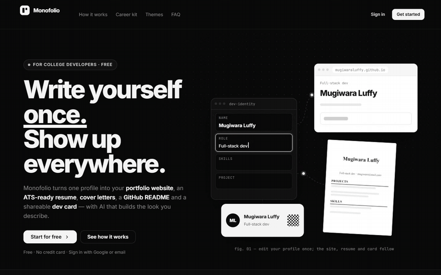
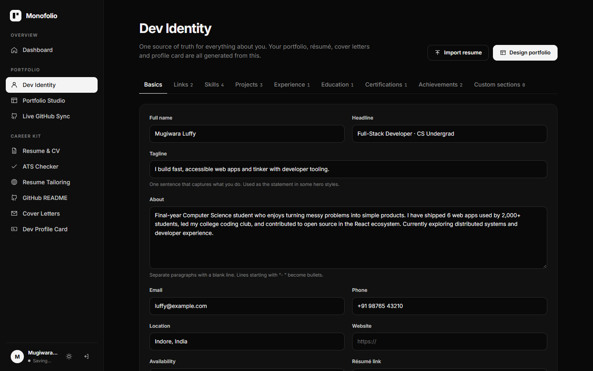
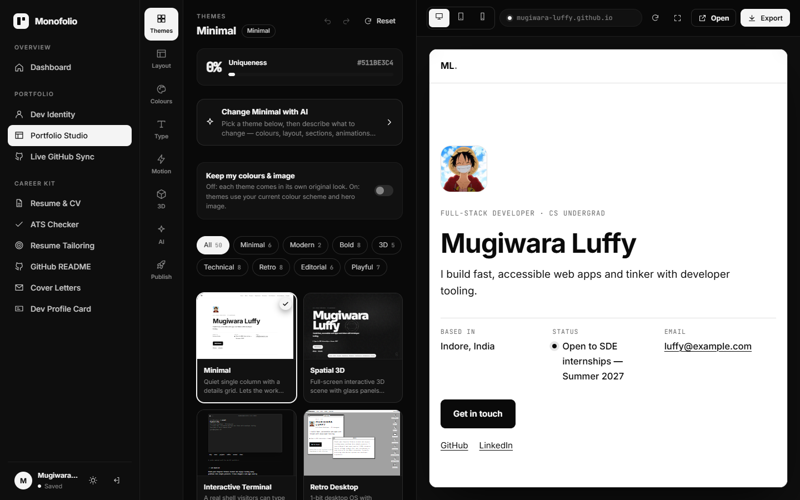
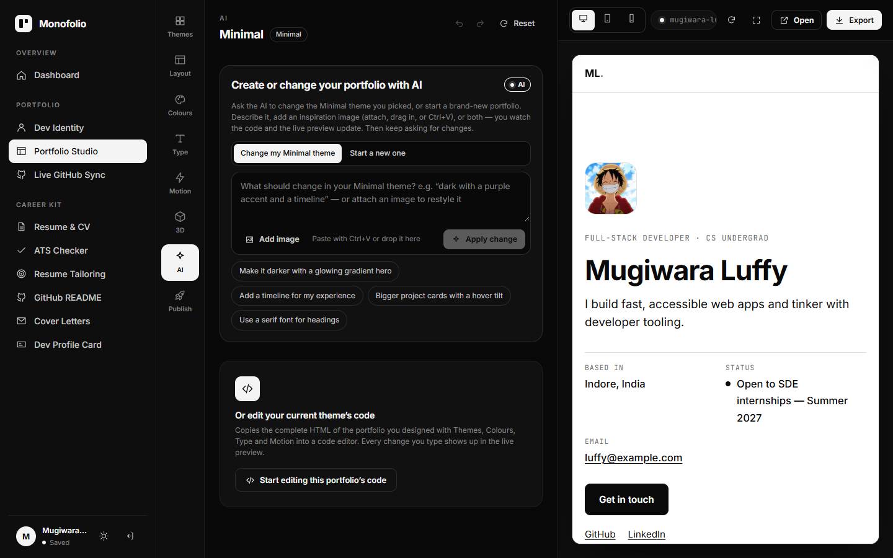
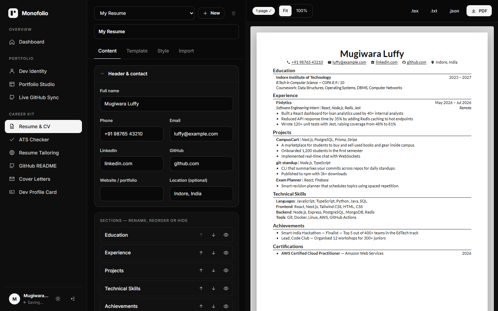
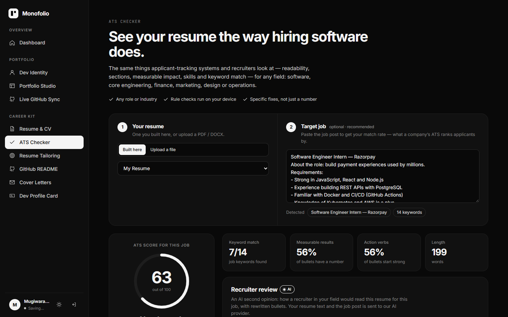
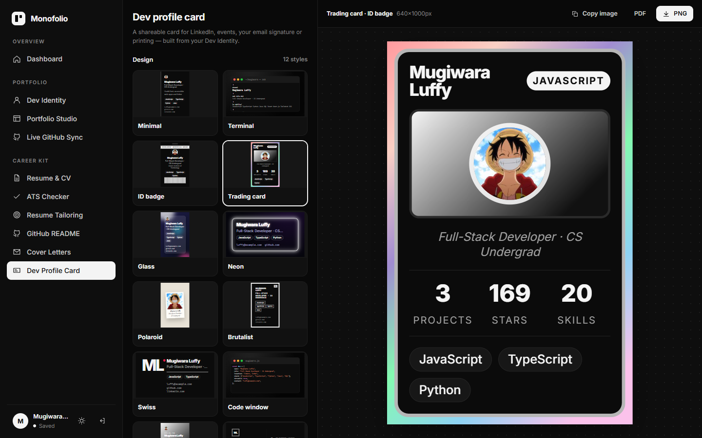
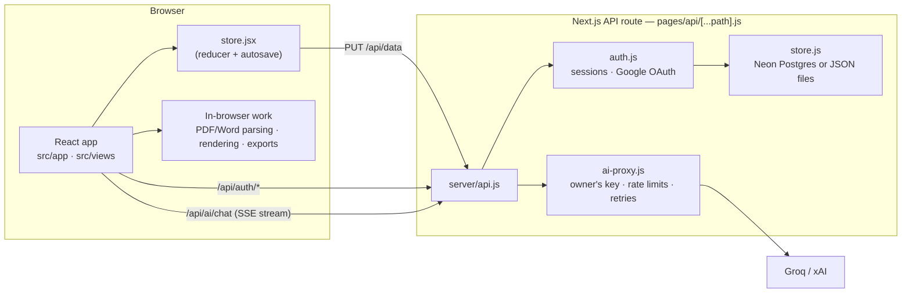

<div align="center">

<picture>
  <source media="(prefers-color-scheme: dark)" srcset="docs/media/logo-dark.svg" />
  
</picture>

# Monofolio

**Write yourself once. Show up everywhere.**

One profile → a portfolio website, an ATS-ready resume, cover letters, a GitHub profile README and a shareable dev card.
Built for college developers, with AI that builds the look you describe.

[](https://nextjs.org)
[](https://react.dev)
[](https://neon.tech)
[](#how-it-works)



**[▶ Watch the full landing page as a video](docs/media/landing.mp4)**

</div>

---

## Contents

- [What it does](#what-it-does)
- [Screenshots](#screenshots)
- [Quick start](#quick-start)
- [Configuration](#configuration)
- [Deploying to Vercel](#deploying-to-vercel)
- [How it works](#how-it-works)
- [Project structure](#project-structure)
- [Scripts and tests](#scripts-and-tests)
- [Security and privacy](#security-and-privacy)

## What it does

Fill in your **Dev Identity** once — or upload your existing resume (PDF / Word) and it fills itself in. Every tool reads from that one profile, so your site, resume, letters and README never disagree.

| Tool | What you get |
| --- | --- |
| **Portfolio Studio** | 50 portfolio themes in 8 styles (minimal, editorial, retro OS, 3D, brutalist…), colours, fonts, motion and 3D scenes — or describe the look (or drop a screenshot) and **AI writes the page**, streaming the code into a live preview. Export one self-contained `index.html` and host it free anywhere. |
| **Resume & CV** | 8 ATS-friendly templates (Jake's Resume, FAANGPath, Awesome CV, Deedy…) and 9 fonts, filled from your profile. Fit-to-one-page, PDF, LaTeX (Overleaf) and plain-text export. |
| **ATS checker** | Scores any resume (built here or uploaded) the way applicant-tracking software reads it — formatting, sections, measurable impact, action verbs and keyword match for a job post, for tech *and* non-tech roles — plus an AI recruiter review. |
| **Resume tailoring** | Paste a job post: see matched and missing keywords, reorder for relevance, and get AI-suggested bullet points. Saves a tailored copy. |
| **Cover letters** | A personal letter for each company, written from your real projects, in 4 tones and 4 designs. |
| **GitHub README** | 35 profile README templates, from clean to wild (stats, badges, the contribution snake), with a live GitHub-style preview. |
| **Dev card** | 12 shareable card designs in 5 sizes (business card, square post, story, LinkedIn banner, ID badge) with a QR code to your portfolio. PNG / PDF. |
| **Accounts** | Email + password or Google sign-in. Everything saves automatically to your account (Neon Postgres). |

New accounts start empty: a sample person (with grey “e.g.” hints in every field) shows how each template looks until you add your own details. In the resume editor the sample stays visible in grey and only the parts you write change, so you always see the finished layout. Samples never end up in downloads.

## Screenshots

<table>
  <tr>
    <td width="50%"><br /><b>Dev Identity</b> — one profile for everything, or import your resume</td>
    <td width="50%"><br /><b>Portfolio Studio</b> — 50 themes, rendered live with your data</td>
  </tr>
  <tr>
    <td><br /><b>AI builder</b> — describe a change or attach an image</td>
    <td><br /><b>Resume builder</b> — content, template, style, import</td>
  </tr>
  <tr>
    <td><br /><b>ATS checker</b> — score for a specific job, with fixes</td>
    <td><br /><b>Dev card</b> — 12 designs, 5 sizes</td>
  </tr>
</table>

## Quick start

You need **Node.js 18.18 or newer**.

```bash
git clone https://github.com/yash-ag15/devora.git
cd devora
npm install
cp .env.example .env.local     # then add your AI key (see below)
npm run dev                    # → http://localhost:5173
```

That's enough to run everything locally: without a database, accounts and saved work are stored as JSON files in `./data`.
For AI features, add one key to `.env.local` — [Groq](https://console.groq.com/keys) has a free tier:

```bash
AI_API_KEY=gsk_...
```

## Configuration

All settings live in `.env.local` (server-side only — nothing here is sent to the browser). See [`.env.example`](.env.example) for the full, commented list.

| Variable | Required | What it does |
| --- | --- | --- |
| `AI_API_KEY` | for AI features | Groq (`gsk_…`) or xAI (`xai-…`) key. The provider is detected from the key. |
| `AI_MODEL`, `AI_VISION_MODEL` | no | Override the text / image models. |
| `AI_RATE_PER_MINUTE`, `AI_RATE_PER_DAY` | no | AI requests allowed per visitor (default 6 / 60). |
| `DATABASE_URL` | in production | Neon Postgres connection string. Tables are created on first start. Empty → JSON files in `./data`. |
| `AUTH_SECRET` | in production | Long random string that signs login cookies. Generated into `./data/.secret` locally if empty. |
| `GOOGLE_CLIENT_ID`, `GOOGLE_CLIENT_SECRET` | no | Enables “Continue with Google”. |
| `APP_URL` | with Google, in production | Your public URL, used to build the Google redirect URI. |

<details>
<summary><b>Setting up Google sign-in</b></summary>

1. Open [Google Cloud Console → Credentials](https://console.cloud.google.com/apis/credentials) → **Create credentials → OAuth client ID → Web application**.
2. **Authorised JavaScript origins:** `http://localhost:5173` (and `https://your-domain` in production).
3. **Authorised redirect URIs:** `http://localhost:5173/api/auth/google/callback` (and `https://your-domain/api/auth/google/callback`).
4. Copy the **Client ID** and the **Client secret** (starts with `GOCSPX-`) into `.env.local`.
5. While the OAuth consent screen is in *Testing*, add your Gmail under **Test users**.

</details>

<details>
<summary><b>Setting up Neon Postgres</b></summary>

1. Create a free project at [neon.tech](https://neon.tech).
2. **Connect** → copy the connection string (keep `?sslmode=require`) into `DATABASE_URL`.
3. Start the app — the `users` and `user_data` tables are created automatically. Accounts created earlier in `./data` are copied into the database once.

</details>

## Deploying to Vercel

1. Import the repository in Vercel — it detects Next.js; no extra settings are needed.
2. Add the environment variables from `.env.local` under **Settings → Environment Variables**, plus `APP_URL=https://your-app.vercel.app` and a long random `AUTH_SECRET`. Then redeploy.
3. In Google Cloud Console, add your Vercel URL as a JavaScript origin and `https://your-app.vercel.app/api/auth/google/callback` as a redirect URI.

> Vercel's disk is read-only, so set `DATABASE_URL` in production — file storage is for local development.

## How it works



- **One page, client-rendered.** `pages/index.jsx` loads the whole app in the browser (hash routes like `/#/studio`), because it relies on iframes, canvas and live previews. Signed-out visitors see the landing page.
- **One profile drives everything.** The profile, designs, resumes and letters live in a single reducer (`src/app/store.jsx`). Every change is saved to the account a moment later (`src/lib/account.jsx`), with a local copy for speed.
- **Most work happens on your device.** Portfolio rendering, resume parsing (pdf.js, mammoth), ATS checks, PDF/PNG exports and the theme thumbnails run in the browser. Only AI requests leave it.
- **AI goes through the server.** The site owner's key stays in `server/ai-proxy.js`; visitors must be signed in, are rate-limited, and responses stream back over server-sent events. The AI portfolio builder edits themes with small search-and-replace patches, so changes survive later theme tweaks.
- **Exports are self-contained.** A portfolio downloads as one `index.html` (styles, scripts and images inlined) that runs on any static host.

## Project structure

```text
pages/                     Next.js entry points (kept thin)
  index.jsx                loads the app in the browser
  api/[...path].js         every /api request → server/api.js
server/                    backend (runs in the API route)
  api.js                   routes /api/auth, /api/data and /api/ai
  auth.js                  sign-up / sign-in, Google OAuth, signed session cookies, saved data
  store.js                 storage: Neon Postgres, or JSON files when DATABASE_URL is empty
  ai-proxy.js              AI gateway: provider, models, rate limits, retries, streaming
src/
  app/                     app shell: Root (auth gate), App (sidebar + routes), nav, store
  views/                   one file per screen (Dashboard, Profile, Resume, Ats, Tailor, …)
    studio/                Portfolio Studio and its Colours / Code panels
  components/              shared UI: ui.jsx primitives, AI composer, code editor, thumbnails
  lib/                     account + autosave, AI client, AI builder, colour maths, GitHub API
  portfolio/               portfolio themes, renderer and the scripts that run inside exported sites
  resume/                  resume model, templates, parser, ATS checker, keywords, tailoring, LaTeX
  profile/                 importing a resume into the Dev Identity profile
  readme/ · cover/ · card/ GitHub README templates, cover letters, dev card designs
  content/                 copy shared by pages (landing-page FAQ)
  styles/                  global CSS, one file per area (base.css holds tokens + primitives)
tests/                     unit tests (node --test)
scripts/                   build helpers (copies the pdf.js worker into public/)
docs/media/                README screenshots and video
```

## Scripts and tests

| Command | What it does |
| --- | --- |
| `npm run dev` | Development server on http://localhost:5173 |
| `npm run build` | Production build |
| `npm start` | Serve the production build |
| `npm test` | Unit tests for the resume parser, profile import, ATS scoring and keyword matching |

## Security and privacy

- API keys and database credentials are read on the server only and are never sent to the browser. Keep them in `.env.local` (git-ignored).
- Passwords are hashed with scrypt; sessions are httpOnly, SameSite cookies signed with `AUTH_SECRET`; sign-in attempts and AI requests are rate-limited.
- Uploaded resumes are parsed in the browser. When a user runs an AI feature, the relevant text (and attached image) is sent to the configured AI provider.
- `npm audit` currently reports moderate advisories in build-time-only dependencies (PostCSS bundled with Next.js, and mammoth's command-line helpers); none of them run in the deployed app.

Found a vulnerability? Please report it privately through the repository’s **Security → Report a vulnerability** .

## Acknowledgements

[Next.js](https://nextjs.org) · [React](https://react.dev) · [pdf.js](https://mozilla.github.io/pdf.js/) · [mammoth](https://github.com/mwilliamson/mammoth.js) · [CodeMirror](https://codemirror.net) · [marked](https://marked.js.org) · [html-to-image](https://github.com/bubkoo/html-to-image) · [jsPDF](https://github.com/parallax/jsPDF) · [node-qrcode](https://github.com/soldair/node-qrcode) · [Neon](https://neon.tech) · resume templates inspired by [Jake's Resume](https://github.com/jakegut/resume), [sb2nov](https://github.com/sb2nov/resume), [Awesome CV](https://github.com/posquit0/Awesome-CV), [Deedy](https://github.com/deedy/Deedy-Resume) and [RenderCV](https://github.com/rendercv/rendercv).
